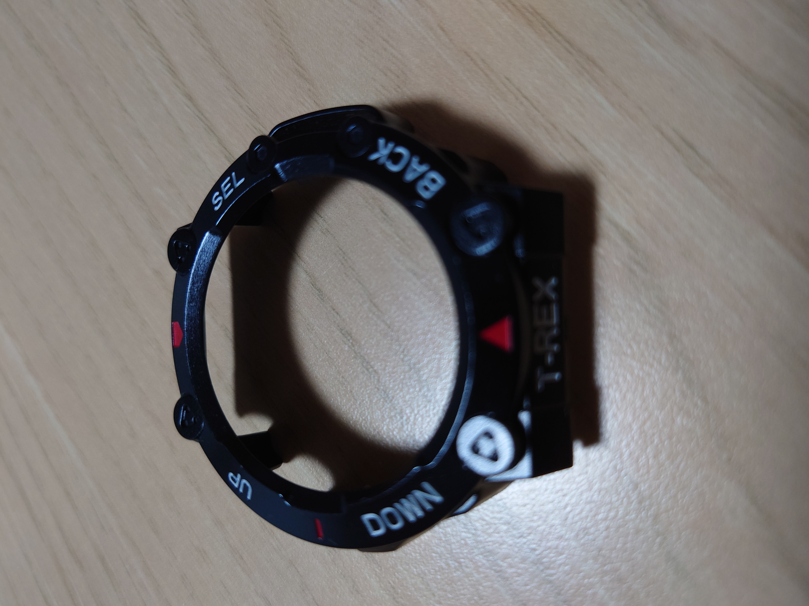

## はじめに：T-Rex 2のフレームに傷が…

Amazfit T-Rex 2を使っていると、どうしてもフレーム部分に傷が付いてしまいます。私も気づいたらフレームに傷が付いていました。

そこで傷を隠すために購入したのが、AliExpressで見つけたバンパーカバーです。価格は625円。カラーはBlack red whiteを選びました。

## 購入したバンパーカバーの詳細

- 商品名：複数の色の保護バンパーカバー、超薄型デザイン、ハードハウジングシェル、耐衝撃性ウォッチケース、Amazfit T Rex 2ウォッチ用
- 価格：625円
- カラー：Black red white
- 購入先：AliExpress
- 10点以上注文で1点あたり443円、2,400円で480円OFFクーポンも利用可能

## 装着感と見た目

実際に装着してみると、まず光沢がありフィット感が優れていることに驚きました。

カバーを付けているようには見えず、違和感がありません。元々そういう時計みたいに見えます。

見た目はちょっとゴツくなりますが、いい意味でタフ感が増すのでおすすめです。

## 耐久性と外し方

カチッとハマるので、少々ぶつけたりしても取れたりしません。

外すときは下から少し広げるような力を加えると簡単に外すことができます。無理に引っ張らないのがコツです。

## まとめ：最初から付けておけばよかった

フレームの傷隠しとして購入しましたが、見た目の向上にもなり、最初から付けておけばよかったと後悔しています。

Amazfit T-Rex 2の傷防止・傷隠しをしたい方には、このバンパーカバーはおすすめです。

[AliExpressの商品ページはこちら](URL_HERE)
