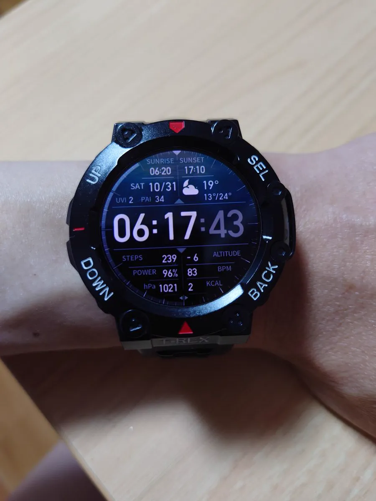
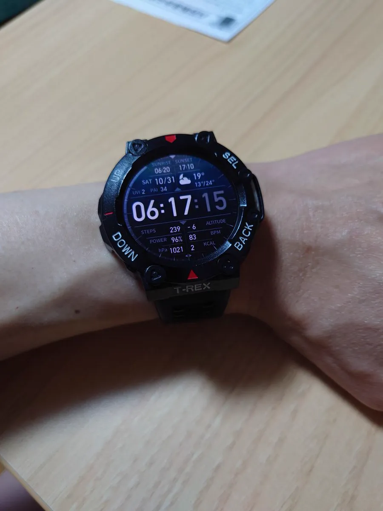
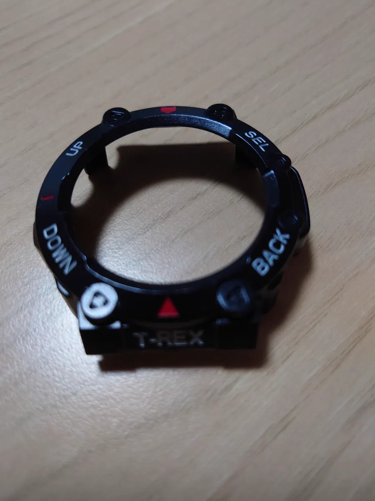
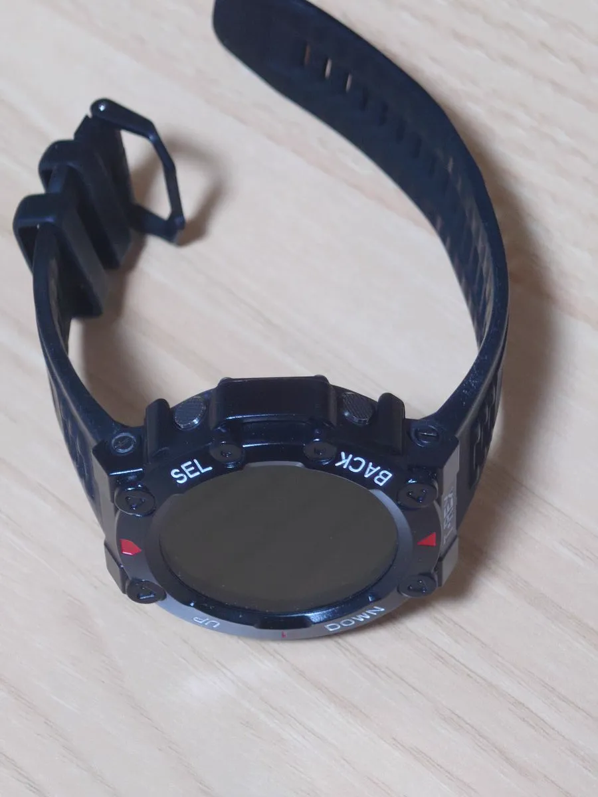
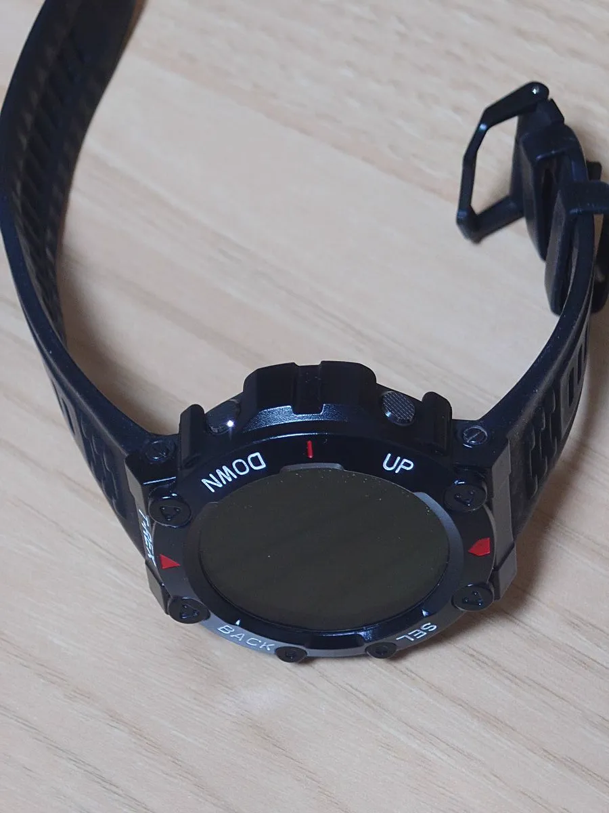

import AffiliateCard from "../../components/AffiliateCard.astro";
import SupportMessage from "../../components/SupportMessage.astro";
import RelatedArticle from "../../components/RelatedArticle.astro";

**Amazfit T-Rex 2のフレームに付いた傷を隠すために、Amazonで787円のバンパーカバーを購入しました。** 付けてみると見た目の変化も少なく、傷の予防にもなっています。

## はじめに

Amazfit（アマズフィット） T-Rex 2を使っていると、フレーム部分に少しずつ傷が付いてきました。気づいたときには、フレームの周りに細かい傷が目立つ状態でした。

傷を隠せないかと探して見つけたのが、Amazonのバンパーカバーです。価格は787円で、カラーは Black Red White を選びました。

## 購入したバンパーカバーの詳細

- 商品名：T Rex 2 用 耐衝撃 保護ケース, ウォッチ バンパー カバー, 防護 ケース for T Rex 2 (Black Red)
- 価格：787円
- カラー：Black Red White
- 購入先：Amazon

## 装着感と見た目

実際に装着してみると、光沢のある質感で、元の時計とは少し印象が変わります。これはこれで合っている感じがしました。フィット感もよく、本体にしっかり馴染んでいます。

カバーを付けている感じはあまりなく、元からこういうデザインの時計のように見えます。

見た目は少しゴツくなりますが、その分タフな印象になりました。この変化は個人的に気に入っています。

## 耐久性と外し方

カチッとはまる作りで、少しくらいぶつけても取れることはありませんでした。

外すときは、下から少し広げるように力を加えると外すことができます。無理に引っ張らないのがコツです。

<SupportMessage />

<AffiliateCard
  banner={true}
  title="Amazon ブラックフライデー"
  description="11月30日（月）〜12月7日（月）開催のセール会場です。先行セールは11月27日（金）から始まります"
  image="/images/amazon-blackfriday-2026.jpg"
  url="https://www.amazon.co.jp/blackfriday?tag=workbenchnote-22"
/>

## まとめ

フレームの傷隠しとして購入しましたが、結果として見た目も好みになりました。最初から付けておけば、傷が付かずに済んだなというのが正直なところです。

同じようにフレームの傷が気になっている場合は、787円で試せる選択肢としてアリだと思います。

## あわせて使いたいアイテム

  

    <AffiliateCard url="https://www.amazon.co.jp/dp/B0B2RCFXX6/ref=cm_sw_r_as_gl_apa_gl_i_F17BJG3CT3Y9S1K0QVNJ?linkCode=ml1&tag=workbenchnote-22&linkId=a9d36f09f38ed7cd1e2ececddeee31fb" image="/images/trex2-film-perfect.avif" title="T-Rex 2用 保護フィルム（画面いっぱいタイプ）" />
  

  

    <AffiliateCard url="https://ja.aliexpress.com/item/1005009240238149.html?srcSns=sns_Copy&businessType=ProductDetail&spreadType=socialShare&aff_fcid=55946cc6a36d4617b6cc46c180d5858c-1793620945521-09722-_c3BSiN6n&tt=CPS_NORMAL&aff_fsk=_c3BSiN6n&aff_platform=shareComponent-detail&sk=_c3BSiN6n&aff_trace_key=55946cc6a36d4617b6cc46c180d5858c-1793620945521-09722-_c3BSiN6n&terminal_id=041fee096f2a4a3999a8d93fe4a4d28f&afSmartRedirect=y" image="/images/aliexpress-trex2-band.webp" title="Amazfit T-Rex 2用 交換用シリコンバンド" buttonText="AliExpressで詳細を見る ▶" />
  

<AffiliateCard url="https://www.amazon.co.jp/dp/B0HFQQ51B6?tag=workbenchnote-22" image="/images/amazon-item.webp" title="T-Rex 2用 バンパーカバー" />
<AffiliateCard url="https://link.amazon/B0eCn4zla" image="/images/amazon-trex3.avif" title="Amazfit T-Rex 3 スマートウォッチ" />

---

## あわせて読みたい

<RelatedArticle url="/blog/trex2-review/" image="/images/trex2-review-hero.webp" title="【T-Rex 2】3年使って分かったリアルな評価。バッテリーの持ちや画面の焼き付きは？" />
<RelatedArticle url="/blog/trex2-protective-film/" image="/images/trex2-film-hero.webp" title="【T-Rex 2】保護フィルムのサイズ選びで失敗しない方法" />
<RelatedArticle url="/blog/sesame-watch-unlock/" image="/images/hero-watch-lock-unlock.webp" title="スマートウォッチでSESAME 5を解錠・施錠する方法" />
