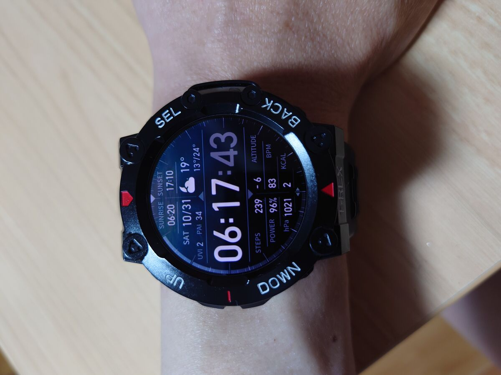
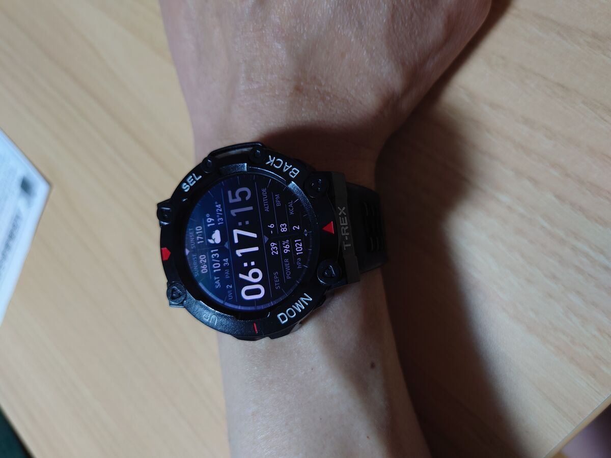
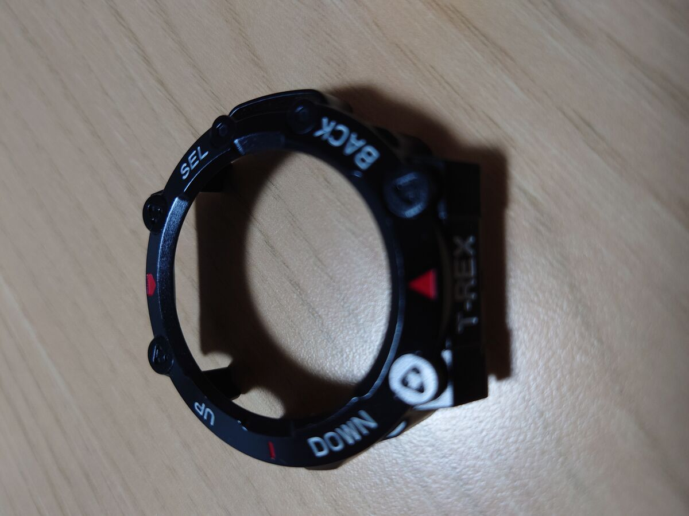
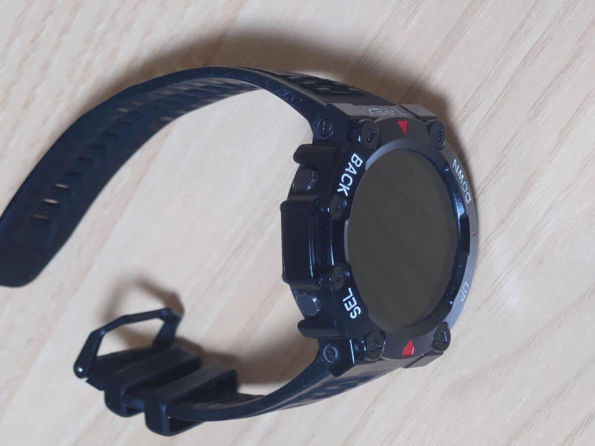
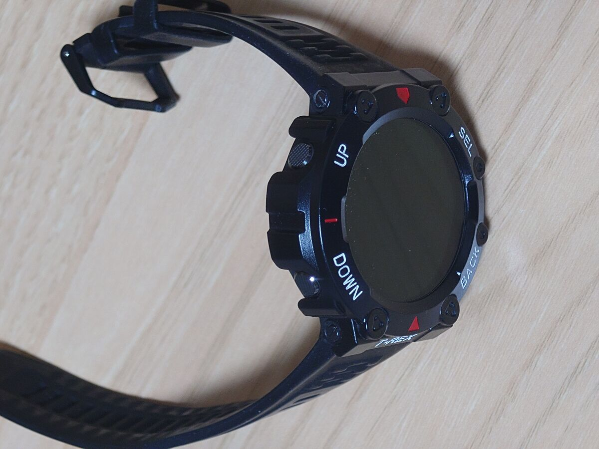

import AffiliateCard from "../../components/AffiliateCard.astro";
import SupportMessage from "../../components/SupportMessage.astro";
import RelatedArticle from "../../components/RelatedArticle.astro";

**結論：Amazfit T-Rex 2のフレームの傷隠し・傷防止には、Amazonの787円のバンパーカバーがおすすめです。** 装着している違和感がなく、タフな見た目になります。

## はじめに：T-Rex 2のフレームに傷が…

Amazfit（アマズフィット） T-Rex 2を使っていると、どうしてもフレーム部分に傷が付いてしまいます。私も気づいたらフレームに傷が付いていました。

そこで傷を隠すために購入したのが、Amazonで見つけたバンパーカバーです。価格は787円。カラーはBlack Red Whiteを選びました。

## 購入したバンパーカバーの詳細

- 商品名：T Rex 2 用 耐衝撃 保護ケース, ウォッチ バンパー カバー, 防護 ケース for T Rex 2 (Black Red)
- 価格：787円
- カラー：Black Red White
- 購入先：Amazon

## 装着感と見た目

実際に装着してみると、光沢があって見た目は良い感じです。元の時計の質感とは変わりますが、これはこれでアリだと思います。フィット感も良好で、しっかり馴染んでくれます。

カバーを付けているようには見えず、違和感がありません。元々そういう時計みたいに見えます。

見た目はちょっとゴツくなりますが、いい意味でタフ感が増すのでおすすめです。

## 耐久性と外し方

カチッとハマるので、少々ぶつけたりしても取れたりしません。

外すときは下から少し広げるような力を加えると簡単に外すことができます。無理に引っ張らないのがコツです。

<SupportMessage />

## まとめ：最初から付けておけばよかった

フレームの傷隠しとして購入しましたが、見た目の向上にもなり、最初から付けておけばよかったと後悔しています。

Amazfit T-Rex 2の傷防止・傷隠しをしたい方には、このバンパーカバーはおすすめです。

## あわせて使いたいアイテム

  

    <AffiliateCard url="https://www.amazon.co.jp/dp/B0B2RCFXX6/ref=cm_sw_r_as_gl_apa_gl_i_F17BJG3CT3Y9S1K0QVNJ?linkCode=ml1&tag=workbenchnote-22&linkId=a9d36f09f38ed7cd1e2ececddeee31fb" image="/images/trex2-film-perfect.avif" title="T-Rex 2用 保護フィルム（画面いっぱいタイプ）" />
  

  

    <AffiliateCard url="https://ja.aliexpress.com/item/1005009240238149.html?srcSns=sns_Copy&businessType=ProductDetail&spreadType=socialShare&aff_fcid=55946cc6a36d4617b6cc46c180d5858c-1793620945521-09722-_c3BSiN6n&tt=CPS_NORMAL&aff_fsk=_c3BSiN6n&aff_platform=shareComponent-detail&sk=_c3BSiN6n&aff_trace_key=55946cc6a36d4617b6cc46c180d5858c-1793620945521-09722-_c3BSiN6n&terminal_id=041fee096f2a4a3999a8d93fe4a4d28f&afSmartRedirect=y" image="/images/aliexpress-trex2-band.webp" title="Amazfit T-Rex 2用 交換用シリコンバンド" buttonText="AliExpressで詳細を見る ▶" />
  

<AffiliateCard url="https://www.amazon.co.jp/dp/B0HFQQ51B6?tag=workbenchnote-22" image="/images/amazon-item.webp" title="T-Rex 2用 バンパーカバー" />
<AffiliateCard url="https://link.amazon/B0eCn4zla" image="/images/amazon-trex3.avif" title="Amazfit T-Rex 3 スマートウォッチ" />
<AffiliateCard url="https://www.amazon.co.jp/s?k=SESAME（セサミ）+5&tag=workbenchnote-22" image="/images/sesame5.avif" title="SESAME 5 スマートロック" />

---

## あわせて読みたい

<RelatedArticle url="/blog/trex2-review/" image="/images/trex2-review-hero.jpg" title="【T-Rex 2】3年使って分かったリアルな評価。バッテリーの持ちや画面の焼き付きは？" />
<RelatedArticle url="/blog/trex2-protective-film/" image="/images/trex2-review-hero.jpg" title="【T-Rex 2】保護フィルムのサイズ選びで失敗しない方法" />
<RelatedArticle url="/blog/sesame-watch-unlock/" image="/images/sesame-watch-unlock-card.jpg" title="スマートウォッチでSESAME 5を解錠・施錠する方法" />
